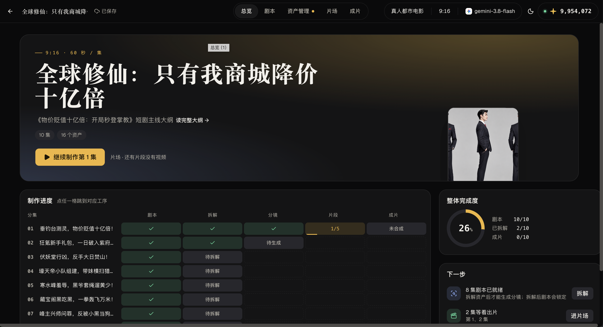
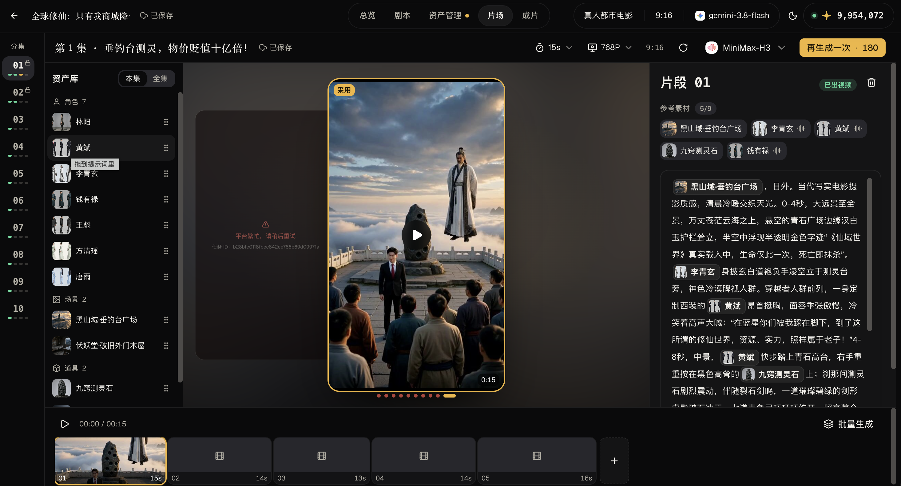
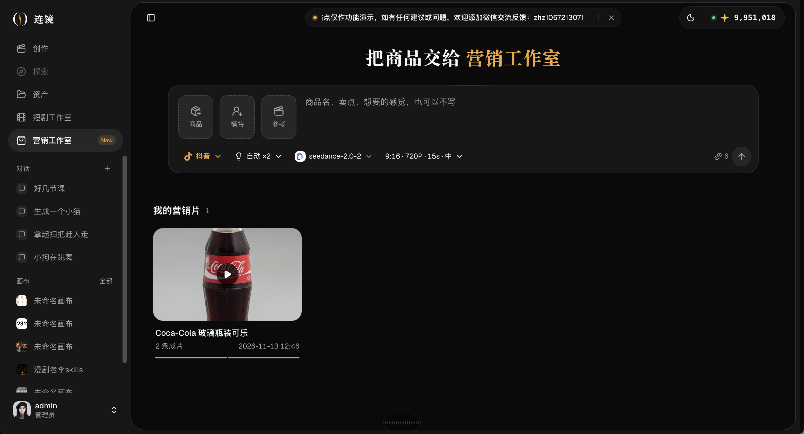
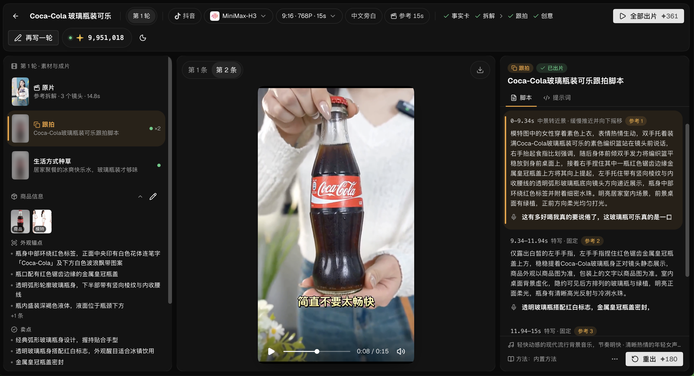
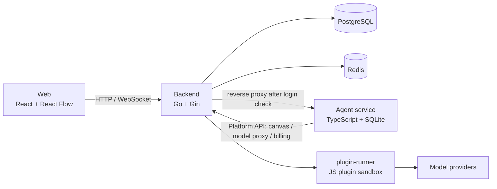

<p align="center">
  <picture>
    <source media="(prefers-color-scheme: dark)" srcset="docs/assets/brand/logo-dark.svg" />
    
  </picture>
</p>

<div align="center">

# 连镜

**Got an idea? Make the video.**

Take the barrier out of AI video creation, so everyone can turn their own ideas into reality.

Import a novel, a set of product images, or just a passing thought.
连镜 breaks it into characters and shots, connects the steps on a canvas, and turns it into video, one step at a time.

[Live demo](https://canvas.vbing.site) · [What you can do](#what-you-can-do) · [Self-hosting](#self-hosting) · [简体中文](README.md)

[](LICENSE)
[](https://github.com/zaylora/video-canvas/tags)
[](https://github.com/zaylora/video-canvas/actions/workflows/ci.yml)

</div>

## What you can do

### Drama Studio: turn a novel into a short drama

- Import a long script or novel, and AI reads it to produce a story outline and episode scripts.
- Characters, scenes and props are broken out and managed as shared assets.
- Shots are turned into video; a character's main image and voice are carried automatically into every shot that uses that character.

<table>
  <tr>
    <th width="50%">Workflow overview</th>
    <th width="50%">Storyboard and video generation</th>
  </tr>
  <tr>
    <td><a href="docs/assets/screenshots/短剧工作室-总览.png"></a></td>
    <td><a href="docs/assets/screenshots/短剧工作室分镜.png"></a></td>
  </tr>
</table>

### Marketing Studio: turn product images into promo videos

- Upload a product image, a model image and a reference video, then pick the platform, video model, aspect ratio and duration.
- AI first sorts out the product's selling points, breaks the reference video into shots, then writes a follow-the-reference script and original creative scripts.
- The generation prompt can be edited by hand. Generate everything at once, or regenerate a single video.

<table>
  <tr>
    <th width="50%">Marketing Studio home</th>
    <th width="50%">Script and video workspace</th>
  </tr>
  <tr>
    <td><a href="docs/assets/screenshots/营销工作室首页.png"></a></td>
    <td><a href="docs/assets/screenshots/营销工作室.png"></a></td>
  </tr>
</table>

### Infinite canvas: connect things any way you like

- Connect text, image, video and audio nodes. The output of an upstream node is used directly as a reference for downstream generation.
- Chat with the Agent inside the canvas. It can create, edit and arrange nodes and search the web, and its changes can be undone.
- Outpaint and edit images; trim videos and capture frames. Every generation keeps its version history, and you can switch between versions at any time.

<a href="docs/assets/screenshots/%E7%94%BB%E5%B8%83.png"></a>

### And more

- **3D director's desk**: Compose shots with mannequins, props and multiple cameras, then export camera views as videos and first-frame images back to the canvas.
- **Home conversations**: Pick a model and parameters on the home page and generate right away. Results are kept as a conversation and can be retried, edited, or used as references for the next generation.
- **Personal asset library**: Upload media and organize it in folders. Generated results can be added in one click and placed back onto any canvas.

## Get started in three steps

1. Open the [live demo](https://canvas.vbing.site) and register.
2. Share your idea or import your material: write what you want to make on the home page, or import a script, a novel or product images.
3. Let AI break it down, then connect the steps into a video: confirm each step in a studio, or connect nodes into a flow on the canvas and generate.

## Supported models

More than 20 built-in model protocol plugins:

| Type | Built-in plugins |
| ---- | ---------------- |
| Text | OpenAI, Anthropic |
| Image | OpenAI, OpenAI-compatible (chat-based image generation), Doubao (Volcengine Ark), Alibaba Bailian |
| Video | Sora, Google Veo (Gemini API / Vertex AI), Doubao (Volcengine Ark), Jimeng, Kling, Vidu, MiniMax Hailuo, Alibaba Bailian, xAI, New API gateway |
| Audio and music | Doubao (Volcengine speech), SunoAPI (music, lyrics), Incho |

When you self-host, which models you can actually use depends on what you configure and enable in the admin console channels. Missing a provider? Write a JS file following the [plugin contract](backend/docs/plugin-contract.md) and upload it.

## Self-hosting

Want to share it with a team, or keep your data in your own hands? 连镜 can be self-hosted with one command.

- **Shared by many users**: accounts, credits (frozen on submission, charged on success, refunded on failure or cancellation), online top-up, usage records and audit logs, all in the admin console.
- **Bring your own models**: each provider protocol is a JS plugin running in an isolated process with no network, file or timer access. Channel keys are stored encrypted and are write-only; the canvas Agent is a separate service and holds no channel keys.
- **Choose where assets live**: local disk by default; in production you can add Alibaba Cloud OSS, Tencent Cloud COS, AWS S3 or Cloudflare R2 in the admin console and choose a default.
- **Upgrades can be rolled back**: the database is backed up before every upgrade and any failed step reverts to the previous version. A super admin can also upgrade from the admin console.

### Deploy with Docker

The server needs [Docker](https://docs.docker.com/get-docker/) (with Compose v2) and `curl`. There is no need to clone the repository:

```bash
curl -fsSL https://raw.githubusercontent.com/zaylora/video-canvas/master/scripts/deploy.sh | bash
```

When it finishes, open `http://{your-ip}:38080`. When accessing through an IP or a domain, pass the matching address with `--origin`, e.g. `bash -s -- --origin http://{your-ip}:38080`; otherwise the cross-origin check rejects requests.

> Before running a remote script, read [`scripts/deploy.sh`](scripts/deploy.sh) and make sure you are comfortable with what it does.

### First run

1. Open the app and register. The first account in the system becomes the super admin.
2. Go to **Admin console → Channels**, choose a provider plugin, enter the Base URL and API key, and save once the connectivity check passes.
3. Fetch or create models under the channel, validate them and enable them.
4. Go back to the home page to generate, or create a canvas and organize the generation flow with nodes.

### Updates

To update to the latest release:

```bash
curl -fsSL https://raw.githubusercontent.com/zaylora/video-canvas/master/scripts/update.sh | bash
```

For custom ports, domains, pinned versions, rollback and the full production configuration, see [Production Docker deployment](docs/docker-production.md) (Chinese).

<a href="docs/assets/screenshots/%E5%90%8E%E5%8F%B0%E7%AE%A1%E7%90%86.png"></a>

<details>
<summary>Architecture</summary>



</details>

## Documentation

Most documents are currently in Chinese.

| Topic                                     | Document                                                                                                |
| ----------------------------------------- | ------------------------------------------------------------------------------------------------------- |
| Development setup, architecture, releases | [Development guide](docs/development.en.md) · [Contributing](CONTRIBUTING.en.md)                         |
| Production deployment                     | [Production Docker deployment](docs/docker-production.md)                                               |
| Backend structure, configuration, API     | [backend/README.md](backend/README.md)                                                                  |
| AI admin API, plugin contract             | [admin-ai-api.md](backend/docs/admin-ai-api.md) · [plugin-contract.md](backend/docs/plugin-contract.md) |
| Product and interaction design            | [docs/design/](docs/design/)                                                                            |
| Changelog                                 | [CHANGELOG.md](CHANGELOG.md)                                                                            |

## Contributing

Issues, feature requests and pull requests are welcome. If you use 连镜, we would also love to hear about your creations, your workflow and any problems you run into.

Before contributing, read the [contributing guide](CONTRIBUTING.en.md) (how to file issues and open pull requests) and the [development guide](docs/development.en.md) (environment setup, coding standards, pre-submit checks).

If 连镜 is useful to you, a ⭐ Star helps more creators find it.

Thanks to everyone who has contributed to 连镜:

<a href="https://github.com/zaylora/video-canvas/graphs/contributors">
  
</a>

## Community

- [LINUX DO](https://linux.do)

## Contact

<table>
  <tr>
    <th>Contact the author</th>
    <th>WeChat group</th>
  </tr>
  <tr>
    <td></td>
    <td></td>
  </tr>
</table>

## License

[MIT](LICENSE)
