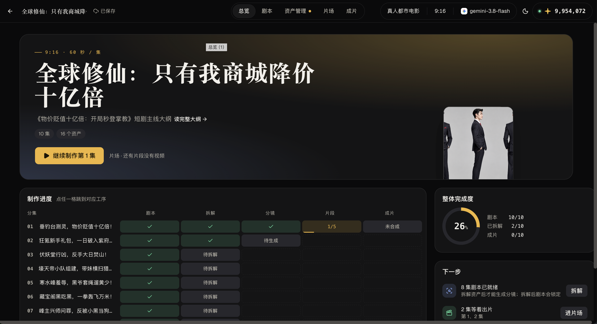
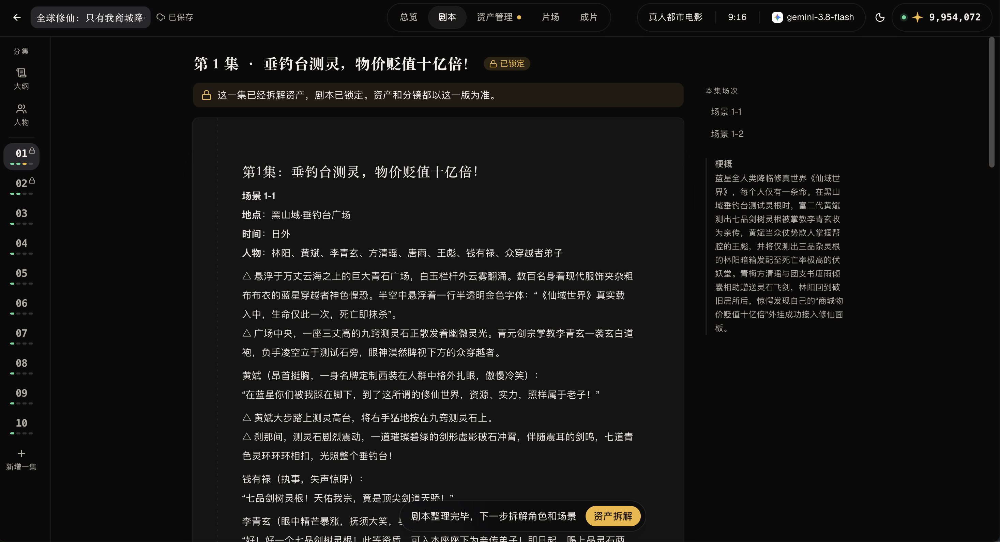
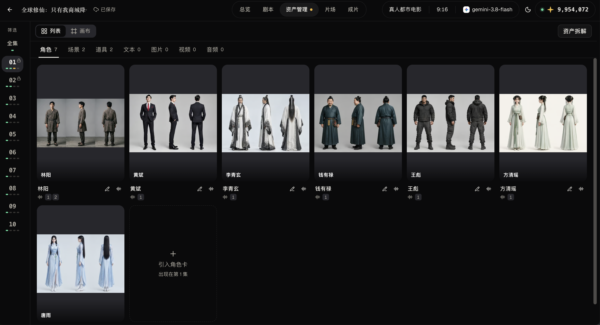
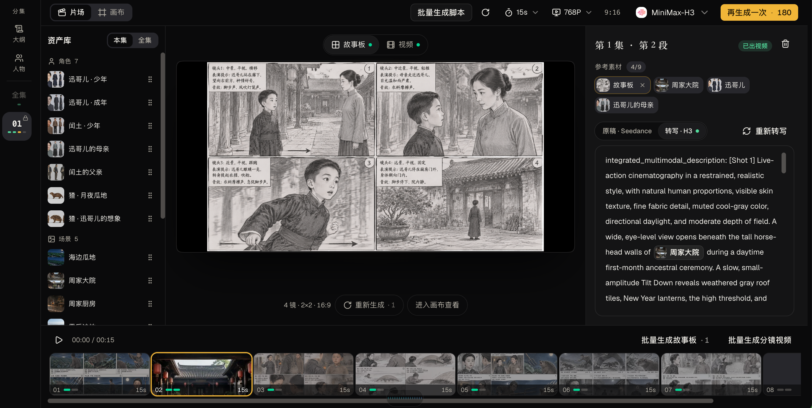
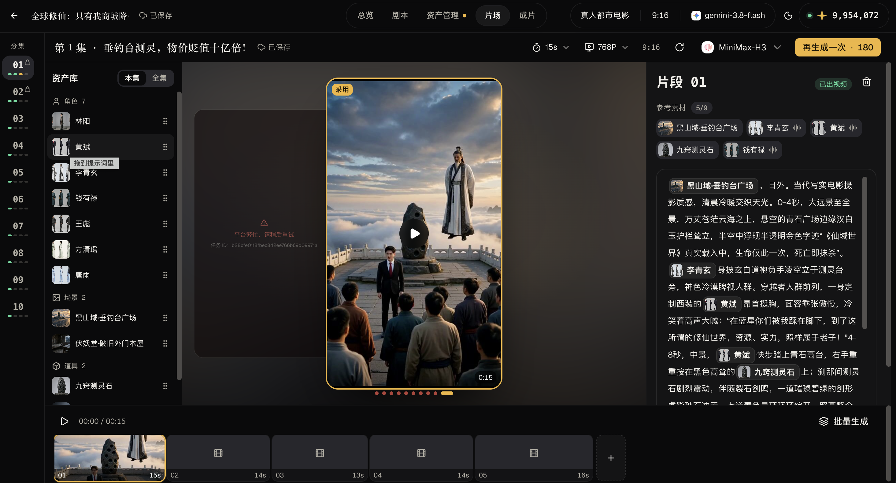
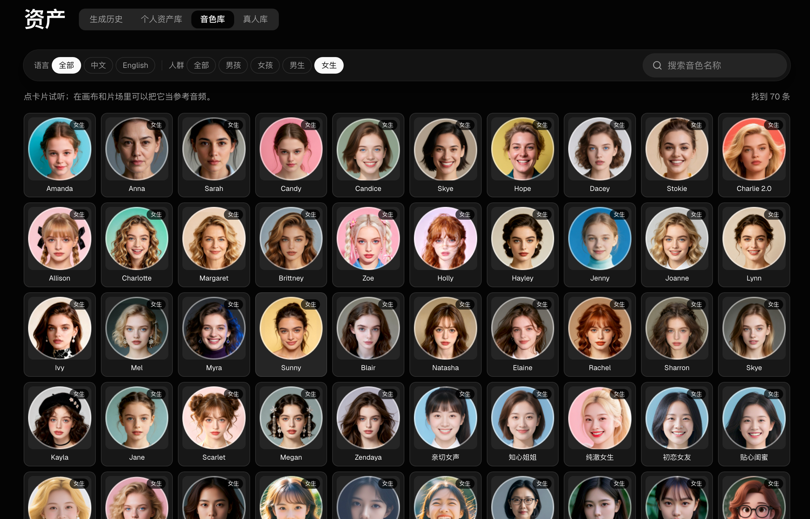
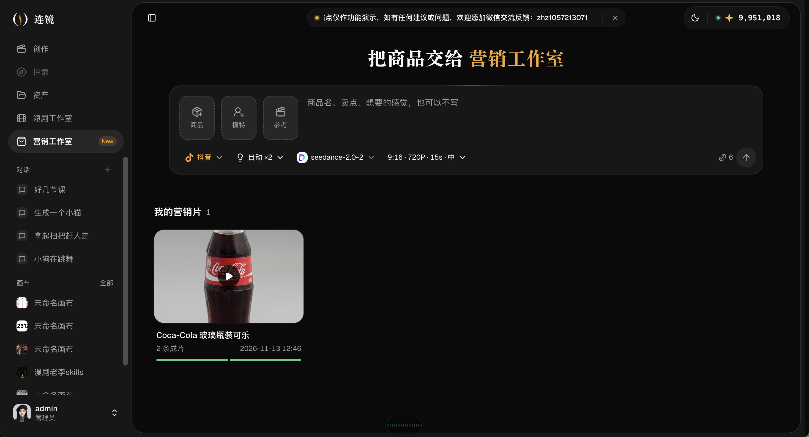
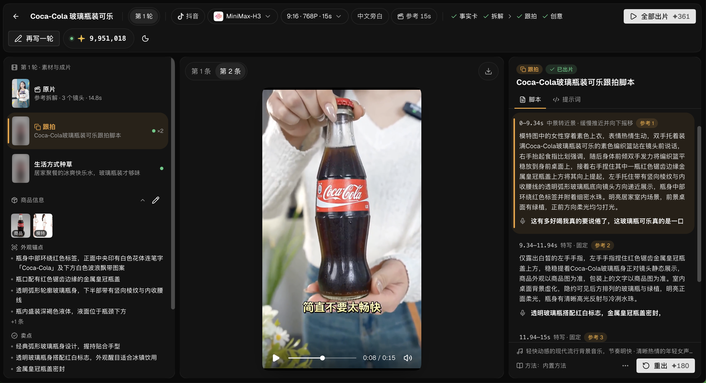
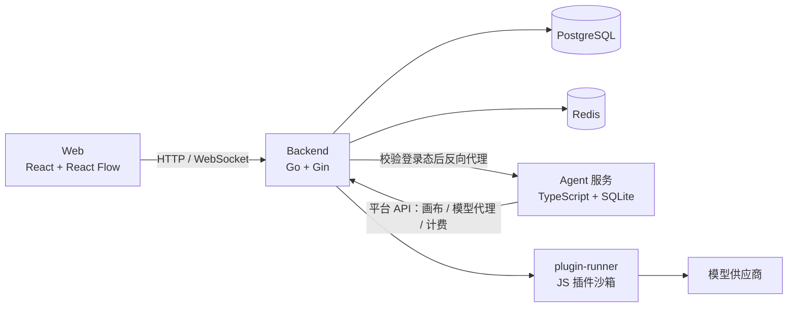

<p align="center">
  <picture>
    <source media="(prefers-color-scheme: dark)" srcset="docs/assets/brand/logo-dark.svg" />
    
  </picture>
</p>

<div align="center">

# 连镜

**有想法，就能出片。**

让 AI 视频创作不再有门槛，每个人都能把自己的想法做出来。

导入一部小说、一组商品图，或者只是一个念头，
连镜帮你拆出角色和分镜，在画布上连成流程，一步步做成视频。

[在线体验](https://canvas.vbing.site) · [你能做什么](#你能做什么) · [自己部署](#自己部署) · [English](README.en.md)

[](LICENSE)
[](https://github.com/zaylora/video-canvas/tags)
[](https://github.com/zaylora/video-canvas/actions/workflows/ci.yml)

</div>

## 你能做什么

### 短剧工作室：把小说做成分集短剧

- 导入长剧本或小说，AI 研读后产出故事大纲和分集剧本。
- 自动拆出角色、场景、道具，统一管理成资产。
- 按分镜生成视频；角色的主图和音色会自动带到用到他的镜头里。

<table>
  <tr>
    <th width="50%">全流程总览</th>
    <th width="50%">剧本与大纲研读</th>
  </tr>
  <tr>
    <td><a href="docs/assets/screenshots/短剧工作室-总览.png"></a></td>
    <td><a href="docs/assets/screenshots/短剧工作室-剧本.png"></a></td>
  </tr>
  <tr>
    <th>角色与场景资产管理</th>
    <th>故事板与提示词转写</th>
  </tr>
  <tr>
    <td><a href="docs/assets/screenshots/短剧工作室资产管理.png"></a></td>
    <td><a href="docs/assets/screenshots/短剧工作室-故事板.png"></a></td>
  </tr>
  <tr>
    <th>分镜片场与视频生成</th>
    <th>音色库</th>
  </tr>
  <tr>
    <td><a href="docs/assets/screenshots/短剧工作室分镜.png"></a></td>
    <td><a href="docs/assets/screenshots/音色库.png"></a></td>
  </tr>
</table>

### 营销工作室：把商品图做成带货短视频

- 上传商品图、模特图和参考视频，选好投放平台、出片模型和画幅时长。
- AI 先整理商品卖点，拆解参考视频的镜头，再写出跟拍脚本和创意脚本。
- 出片提示词可以手改；一键全部出片，也可以单条重出。

<table>
  <tr>
    <th width="50%">营销工作室首页</th>
    <th width="50%">脚本与成片创作台</th>
  </tr>
  <tr>
    <td><a href="docs/assets/screenshots/营销工作室首页.png"></a></td>
    <td><a href="docs/assets/screenshots/营销工作室.png"></a></td>
  </tr>
</table>

### 无限画布：想怎么连，就怎么连

- 文本、图片、视频、音频节点互相连线，上游的结果直接作为下游生成的参考。
- 在画布里和 Agent 对话，它能帮你创建、编辑和排列节点，联网搜索资料，改动可以撤销。
- 图片扩图和编辑、视频修剪和截取帧；每次生成都保留历史版本，随时切换。

<a href="docs/assets/screenshots/%E7%94%BB%E5%B8%83.png"></a>

### 还有这些

- **3D 导演台**：用人台、道具和多机位摆出构图，把机位画面导出为视频和首帧图片，再放回画布。
- **首页对话**：选好模型和参数直接生成，结果按对话保存，可以重试、再编辑，或作为下一次生成的参考素材。
- **个人资产库**：上传素材、按文件夹整理；生成结果一键入库，也能从资产库添加到画布。

## 三步开始

1. 打开[在线体验](https://canvas.vbing.site)，注册账号。
2. 说出想法，或导入素材：在首页写下你想做的，或者导入剧本、小说、商品图。
3. 让 AI 帮你拆解，再连起来出片：在工作室里一步步确认，或在画布上把节点连成流程，生成视频。

## 支持的模型

内置 20 多个模型协议插件：

| 类型       | 内置插件                                                                                                                    |
| ---------- | --------------------------------------------------------------------------------------------------------------------------- |
| 文本       | OpenAI、Anthropic                                                                                                           |
| 图片       | OpenAI、OpenAI 兼容（对话生图）、豆包（火山方舟）、阿里云百炼                                                               |
| 视频       | Sora、Google Veo（Gemini API / Vertex AI）、豆包（火山方舟）、即梦、可灵、Vidu、MiniMax 海螺、阿里云百炼、xAI、New API 网关 |
| 音频与音乐 | 豆包（火山语音）、SunoAPI（音乐、歌词）、音潮 Incho                                                                         |

自己部署时，具体能用哪些模型取决于你在后台渠道里配置并启用了什么。没有你要的供应商？按[插件契约](backend/docs/plugin-contract.md)写一个 JS 文件上传即可。

## 自己部署

想给团队共用，或者让数据留在自己手里？连镜可以一条命令自托管。

- **多人共用**：账号、积分（提交时冻结，成功扣除，失败或取消退回）、在线充值、用量记录和操作审计，都在管理后台里。
- **模型自己接**：每种供应商协议是一个 JS 插件，运行在没有网络、文件和定时器权限的隔离进程里。渠道 Key 加密保存，只能写入，不能读出；画布 Agent 是独立服务，不持有渠道密钥。
- **素材存储可选**：默认本地磁盘；生产环境可在后台添加阿里云 OSS、腾讯云 COS、AWS S3、Cloudflare R2，并指定默认存储。
- **升级可回退**：升级前自动备份数据库，任何一步失败自动退回原版本；超级管理员也可以在后台一键升级。

### Docker 部署

服务器需要安装 [Docker](https://docs.docker.com/get-docker/)（含 Compose v2）和 `curl`。无需先克隆仓库：

```bash
curl -fsSL https://raw.githubusercontent.com/zaylora/video-canvas/master/scripts/deploy.sh | bash
```

完成后访问 `http://{你的ip}:38080`。通过 IP 或域名访问时，需用 `--origin` 指定对应的访问地址，如 `bash -s -- --origin http://{你的ip}:38080`，否则跨域校验会拒绝请求。

> 运行远程脚本前，建议先阅读 [`scripts/deploy.sh`](scripts/deploy.sh) 并确认脚本内容。

### 首次使用

1. 打开页面注册账号。首个注册账号会成为超级管理员。
2. 进入 **管理后台 → 渠道**，选择供应商插件，填写 Base URL 和 API Key，通过连通性检查后保存。
3. 在渠道下拉取或新建模型，完成校验并启用。
4. 返回首页生成素材，或者新建画布，通过节点组织生成流程。

### 更新

更新至最新正式版本：

```bash
curl -fsSL https://raw.githubusercontent.com/zaylora/video-canvas/master/scripts/update.sh | bash
```

<a href="docs/assets/screenshots/%E5%90%8E%E5%8F%B0%E7%AE%A1%E7%90%86.png"></a>

<details>
<summary>架构图</summary>



</details>

## 文档

| 内容                         | 文档                                                                                                    |
| ---------------------------- | ------------------------------------------------------------------------------------------------------- |
| 开发环境、架构、测试与发布   | [开发指南](docs/development.md) · [贡献指南](CONTRIBUTING.md)                                           |
| 生产部署                     | [生产 Docker 部署](docs/docker-production.md)                                                           |
| 后端结构、配置项、完整接口表 | [backend/README.md](backend/README.md)                                                                  |
| AI 管理接口、插件契约        | [admin-ai-api.md](backend/docs/admin-ai-api.md) · [plugin-contract.md](backend/docs/plugin-contract.md) |
| 产品与交互设计               | [docs/design/](docs/design/)                                                                            |
| 版本变更                     | [CHANGELOG.md](CHANGELOG.md)                                                                            |

## 参与贡献

欢迎提交 Issue、功能建议和 Pull Request。如果你正在使用连镜，也欢迎分享你的作品、工作流和使用体验。

开始贡献前，请先阅读 [贡献指南](CONTRIBUTING.md)（如何提 Issue 和 PR）和 [开发指南](docs/development.md)（环境、规范、提交前检查）。

如果连镜对你有帮助，欢迎给项目一个 ⭐ Star，让更多创作者发现它。

感谢每一位参与连镜的贡献者：

<a href="https://github.com/zaylora/video-canvas/graphs/contributors">
  
</a>

## 致谢与社区

- [LINUX DO](https://linux.do) — 新的理想型社区

## 联系我们

<table>
  <tr>
    <th>联系作者</th>
    <th>加入交流群</th>
  </tr>
  <tr>
    <td></td>
    <td></td>
  </tr>
</table>

## 许可证

[MIT](LICENSE)
